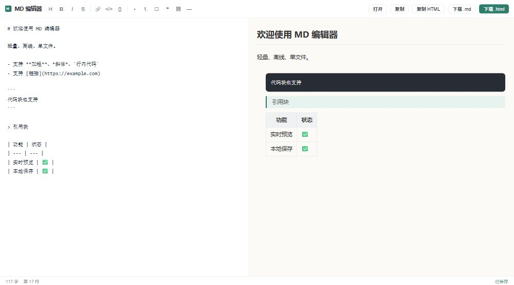

# MDEditor

一个像 TXT 编辑器一样轻量的 **本地 Markdown 编辑器**——Windows 桌面 GUI（Rust + egui），全宽编辑区带语法高亮，一键在默认浏览器中网页预览，**绿色单文件，双击即用**。



## 特性

- **极轻量**：静态编译的单文件 `mdedit.exe`（约 14 MB），不依赖任何第三方运行库，拷贝到任意 Windows 10/11 即可运行
- **绿色免安装**：无控制台窗口（Windows GUI 子系统），双击打开、即开即用
- **语法高亮**：标题、代码块、引用、行内代码、加粗、斜体、链接按不同颜色显示，自动加载系统中文字体（微软雅黑优先）
- **网页预览**：`Ctrl+P` 把当前内容渲染成完整 HTML 并用系统默认浏览器打开，改完再点一次即刷新
- **导出 HTML**：`Ctrl+E` 另存为独立 `.html` 文件
- **纯本地**：不联网、不上传、无账号
- **设为默认打开方式**：一键把程序注册为 `.md` / `.markdown` 的默认打开程序（写 HKCU，免管理员权限）
- **自动保存草稿**：内容自动存到同目录 `mdedit_draft.md`，下次启动自动恢复

## 界面布局

- **顶部菜单栏**：文件 / 编辑 / 帮助
- **格式工具栏**：`▶ 网页预览` + 标题、加粗、斜体、删除线、链接、行内代码、代码块、无序列表、有序列表、任务列表、引用、表格、分割线
- **全宽编辑区**：Markdown 编辑 + 语法高亮
- **底部状态栏**：当前文件路径、字数、行数、光标行列

移动端/窄屏预览效果：


## 下载与使用

**推荐从 [Releases](https://github.com/Photoair/MDEditor/releases/latest) 下载已打包的 Windows x64 文件：**

| 文件 | 大小 | 说明 |
|------|------|------|
| **mdedit.exe** | 约 14 MB | **绿色单文件版（推荐）**，双击即用，无需安装、无需任何依赖 |
| **MDEditor_setup_1.0.0.exe** | 约 5.7 MB | Inno Setup 安装包，含开始菜单/桌面快捷方式与 `.md` 文件关联 |

直接下载链接（v1.0.0）：

- https://github.com/Photoair/MDEditor/releases/download/v1.0.0/mdedit.exe
- https://github.com/Photoair/MDEditor/releases/download/v1.0.0/MDEditor_setup_1.0.0.exe

命令行带文件打开：

```
mdedit.exe 文档.md
```

> 仓库 `mdedit-gui/` 目录下也同时保留了这两个文件的副本，便于随源码一起查看。

## 快捷键

| 快捷键 | 功能 |
|--------|------|
| `Ctrl+N` | 新建 |
| `Ctrl+O` | 打开文件 |
| `Ctrl+S` | 保存 |
| `Ctrl+Shift+S` | 另存为 |
| `Ctrl+E` | 导出 HTML |
| `Ctrl+P` | 网页预览 |

## 从源码构建

环境：Rust stable（Windows GNU 工具链）+ MSYS2（ucrt64 的 gcc 作链接器）。

```powershell
$env:Path = "$env:USERPROFILE\.cargo\bin;C:\msys64\ucrt64\bin;" + $env:Path
cd mdedit-gui
cargo build --release
```

产物：`mdedit-gui\build\target\release\mdedit.exe`

## 技术栈

| 依赖 | 用途 |
|------|------|
| `eframe` / `egui` 0.29 | 即时模式 GUI 框架 |
| `pulldown-cmark` 0.12 | Markdown 解析 |
| `rfd` 0.14 | 原生系统文件对话框 |
| `winreg` 0.55 | 注册表（默认打开方式） |
| `embed-resource` 2 | 嵌入应用图标与版本信息 |

## 源码结构

| 文件 | 说明 |
|------|------|
| `mdedit-gui/src/main.rs` | 主程序：窗口、菜单、工具栏、全宽编辑区、文件读写、HTML 导出、网页预览、快捷键、默认打开方式 |
| `mdedit-gui/src/highlight.rs` | 编辑区 Markdown 语法高亮（LayoutJob） |
| `mdedit-gui/src/preview.rs` | Markdown 事件 → 富文本块，供导出 / 网页预览渲染 |
| `mdedit-gui/src/wysiwyg.rs` | 所见即所得辅助 |
| `mdedit-gui/build.rs` / `app.rc` / `mdedit.ico` | 图标与版本信息嵌入 |
| `mdedit-gui/setup.iss` | Inno Setup 打包脚本 |
| `mdedit-gui/使用说明.md` | 完整中文使用说明 |

## 许可证

MIT
